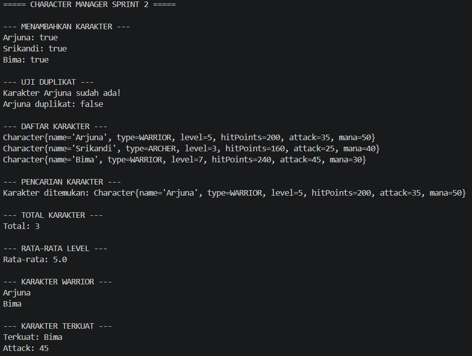
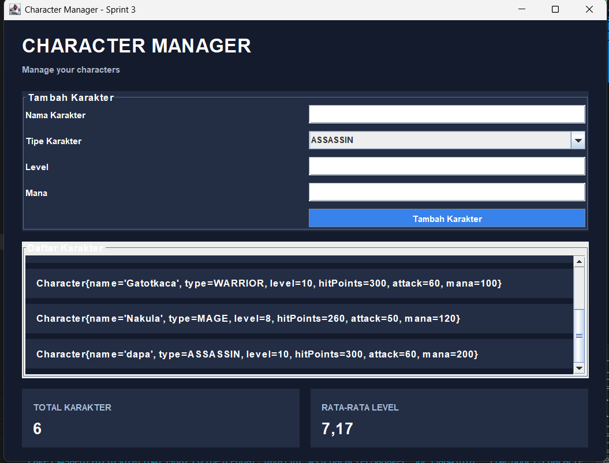
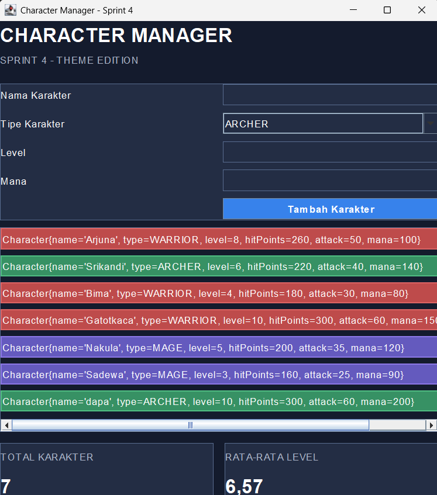
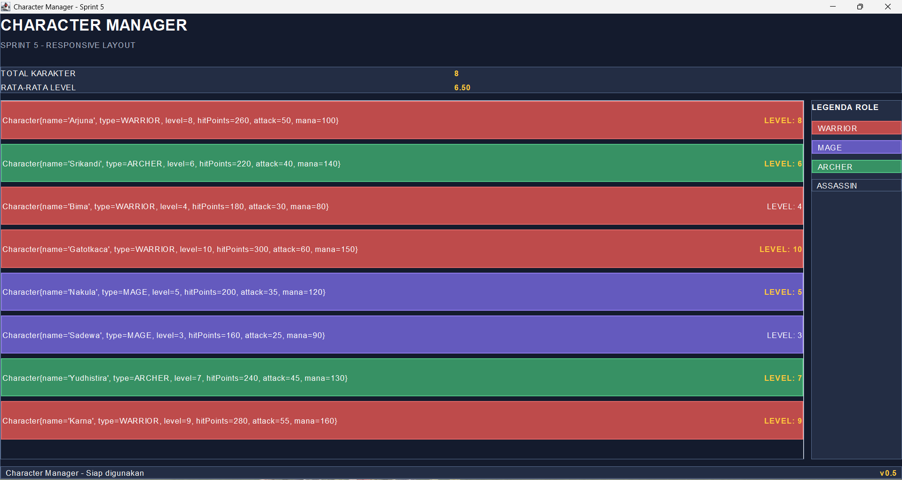
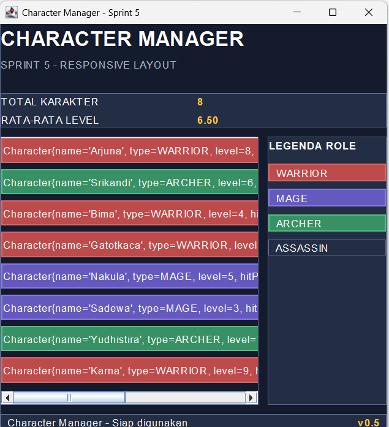
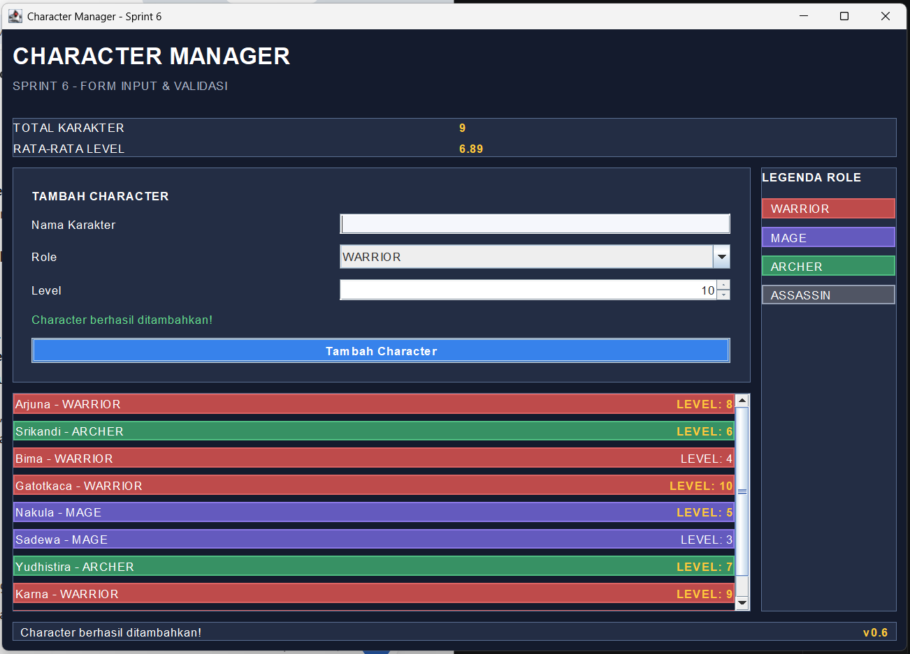

# Character Manager — Java Visual SIH-6406

**Universitas Prima Indonesia (UNPRI)**

Project Character Manager merupakan aplikasi berbasis Java yang dikembangkan sebagai implementasi pembelajaran Object-Oriented Programming (OOP). Pengembangan dilakukan secara bertahap melalui beberapa sprint tugas praktikum.

## Daftar Tugas

- [TP3 — Class Skeleton](#tp3--class-skeleton)
- [TP5 — Character Manager](#tp5--character-manager)
- [TP8 — MainWindow dan GUI](#tp8--mainwindow-dan-gui)
- [TP10 — AppTheme](#tp10--apptheme)
- [TP12 — Responsive Layout](#tp12--responsive-layout)
- [TP14 — Input Validation](#tp14--input-validation)

---

## TP3 — Class Skeleton

Membangun struktur dasar aplikasi menggunakan konsep Object-Oriented Programming (OOP).

Implementasi:
- CharacterType menggunakan enum.
- Character sebagai model class.
- Constructor, getter, setter, dan toString().

### Screenshot

---

## TP5 — Character Manager

Mengembangkan pengelolaan data karakter menggunakan class CharacterManager.

Implementasi:
- addCharacter()
- findByName()
- removeCharacter()
- getTotalCharacters()
- getAllCharacters()
- equals() untuk membandingkan nama karakter.
- Validasi agar nama karakter duplikat tidak ditambahkan.

### Screenshot

**Pengujian CRUD**

**Analisis**

---

## TP8 — MainWindow dan GUI

Mengembangkan aplikasi dari console menjadi Graphical User Interface (GUI) menggunakan Java Swing.

Implementasi:
- MainWindow menggunakan JFrame.
- Menampilkan data karakter secara dinamis.
- Menggunakan SwingUtilities.invokeLater().
- Menerapkan konsep pemisahan model dan view.

### Screenshot

**Sebelum**

**Sesudah**

---

## TP10 — AppTheme

Mengembangkan pengaturan tema aplikasi melalui class AppTheme agar pengaturan tampilan lebih terpusat.

### Screenshot

**Sebelum**

**Sesudah**

---

## TP12 — Responsive Layout

Mengembangkan tampilan aplikasi agar dapat menyesuaikan ukuran jendela.

### Screenshot

**Ukuran Awal**

**Jendela Lebar**

**Jendela Kecil**

---

## TP14 — Input Validation

Mengembangkan validasi input untuk memastikan data karakter yang dimasukkan sesuai dengan ketentuan aplikasi.

Implementasi:
- Validasi nama kosong.
- Validasi nama duplikat.
- Menampilkan pesan kesalahan ketika input tidak valid.
- Menampilkan pesan keberhasilan ketika karakter berhasil ditambahkan.

### Screenshot

**Validasi Nama Kosong**

**Validasi Nama Duplikat**

**Berhasil Menambahkan Character**

---

## Teknologi

- Java
- Java Swing
- Object-Oriented Programming (OOP)
- Visual Studio Code
- Git dan GitHub

---

**Universitas Prima Indonesia (UNPRI)**