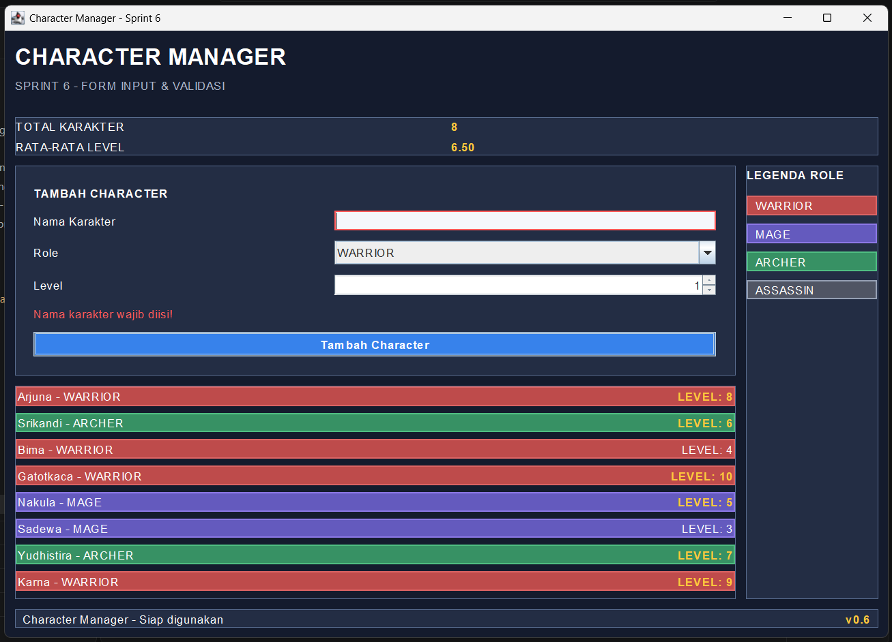

## TP14 — Character Manager Sprint #6
### Form Input, Validasi & Analisis MVC

### A. Deskripsi Proyek

Pada TP14, aplikasi Character Manager dikembangkan dengan menambahkan form input karakter, validasi data, serta penerapan prinsip Model-View-Controller (MVC).

Pengembangan ini berfokus pada validasi nama karakter, pemilihan role, pengaturan level, pencegahan nama duplikat, dan pembatasan level khusus untuk karakter MAGE.

### B. Implementasi Fitur

Fitur yang diterapkan pada Sprint 6:

1. **CharacterFormPanel** — Panel form untuk memasukkan data karakter.
2. **JTextField** — Input nama karakter.
3. **JComboBox** — Pemilihan role karakter.
4. **JSpinner** — Pengaturan level karakter dari 1 sampai 99.
5. **Validasi Nama** — Pemeriksaan kelengkapan, panjang, format, dan keunikan nama.
6. **Inline Validation** — Menampilkan pesan kesalahan pada form dan border merah.
7. **CharacterManager.isNameTaken()** — Memeriksa apakah nama karakter sudah digunakan.
8. **Model Validation** — Constructor Character memvalidasi nama, role, dan level.
9. **Dynamic Refresh** — Daftar karakter diperbarui setelah karakter berhasil ditambahkan.

### C. Mini-Challenge

Mini-Challenge yang diterapkan:

1. Karakter MAGE memiliki batas level maksimal 60.
2. Nama karakter dibatasi maksimal 20 karakter.
3. Nama karakter tidak boleh mengandung angka atau format yang tidak sesuai.

Validasi batas level MAGE ditempatkan pada Model agar aturan bisnis tetap berlaku meskipun objek dibuat dari bagian aplikasi yang berbeda.

### D. Hasil Pengujian

Pengujian dilakukan untuk memastikan validasi input dan aturan bisnis berjalan sesuai ketentuan.

| No. | Skenario Pengujian | Hasil yang Diharapkan |
|---|---|---|
| 1 | Nama kosong | Ditolak |
| 2 | Nama hanya berisi spasi | Ditolak |
| 3 | Nama lebih dari 20 karakter | Ditolak |
| 4 | Nama mengandung angka | Ditolak |
| 5 | Nama duplikat | Ditolak |
| 6 | MAGE dengan level 61 | Ditolak |
| 7 | WARRIOR dengan level 1 | Berhasil |
| 8 | Karakter valid dengan level 10 | Berhasil |

### E. Screenshot Pengujian

**1. Validasi Nama Kosong**

**2. Validasi Nama Duplikat**

**3. Penambahan Karakter Berhasil**

### F. Analisis MVC

Penerapan validasi dibagi berdasarkan tanggung jawab masing-masing bagian MVC. View bertanggung jawab memeriksa input pengguna dan menampilkan pesan kesalahan. Model bertanggung jawab menjaga aturan bisnis, seperti validasi nama, role, dan batas level MAGE. CharacterManager bertanggung jawab mengelola data karakter serta memeriksa nama duplikat.

Pemisahan tanggung jawab tersebut membantu menjaga struktur aplikasi agar lebih terorganisasi dan mudah dikembangkan.

### G. Dokumentasi Analisis TP14

Dokumen analisis TP14 membahas proses validasi input, pemisahan tanggung jawab View dan Model, penerapan aturan bisnis, serta pengujian aplikasi.

**Google Docs:** https://1drv.ms/w/c/2131cfafda44bcb4/IQCaAHaLRhmJTo-anGYgU6S2ARCGXEzbxmLt3qJMFZcEAWY?e=AaYqlm

### H. Kesimpulan

Melalui TP14, aplikasi Character Manager berhasil dikembangkan dengan form input dan validasi data. Validasi dilakukan pada View dan Model sesuai tanggung jawab masing-masing. Aplikasi juga menerapkan aturan tambahan berupa batas level MAGE maksimal 60 dan pembatasan panjang nama karakter.
