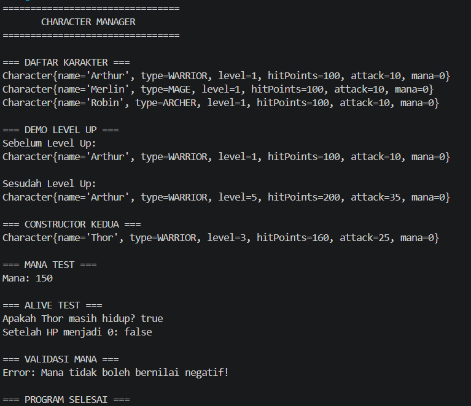
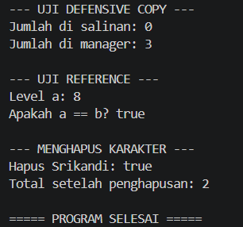

# Character Manager — Java Visual SIH-6406

**Universitas Prima Indonesia (UNPRI)**

Project Character Manager merupakan aplikasi berbasis Java yang dikembangkan sebagai implementasi pembelajaran Object-Oriented Programming (OOP). Project ini terdiri dari TP3 Sprint 1 dan TP5 Sprint 2.

---

# TP3 — Character Manager Sprint #1

## Deskripsi Project

Character Manager merupakan aplikasi berbasis Java yang dikembangkan untuk mengelola data karakter menggunakan konsep Object-Oriented Programming (OOP).

Pada TP3 Sprint-1 ini, project dikembangkan dengan menerapkan class, object, constructor, enum, encapsulation, getter, setter, serta method tambahan berupa `isAlive()` dan atribut `mana`.

Project ini merupakan implementasi dan pengembangan dari materi AP3 Belajar Praktik serta analisis desain berdasarkan AP2 Belajar Teori.

## Teknologi yang Digunakan

- Java JDK 17
- Visual Studio Code
- Git
- GitHub

## Implementasi Fitur

### A. Implementasi Dasar

1. Package `com.unpri.charactermanager.model`.
2. Enum `CharacterType` dengan empat konstanta.
3. Class `Character` dengan dua constructor.
4. Getter dan setter lengkap.
5. Method `toString()`.
6. Program utama untuk menampilkan tiga karakter dan demonstrasi level up.

### B. Mini-Challenge

1. Menambahkan atribut private `mana` bertipe `int`.
2. Membuat getter `getMana()`.
3. Membuat setter `setMana(int mana)` dengan validasi nilai negatif menggunakan `IllegalArgumentException`.
4. Memperbarui `toString()` agar menampilkan mana.
5. Menambahkan method `isAlive()` yang mengembalikan `true` jika `hitPoints > 0`.

## Screenshot Hasil Program

Bukti hasil pengujian program Character Manager Sprint 1:

## Git Branch

Branch pengembangan TP3: `sprint-1`

## Dokumentasi Analisis Desain

Google Docs — Bagian D:

[Dokumentasi Analisis TP3](https://1drv.ms/w/c/2131cfafda44bcb4/IQALqiI7G596R6zoCvr8Mt-1AWZWWpwnjIgt0uxH97bJ-Tg?e=dS0EI6)

---

# TP5 — Character Manager Sprint #2

## Deskripsi Project

Pada TP5 Sprint 2, project Character Manager dikembangkan lebih lanjut dengan membuat class `CharacterManager` untuk mengelola objek karakter.

Pengembangan ini berfokus pada pengelolaan data karakter, pencegahan nama duplikat, pencarian dan penghapusan karakter, analisis data, serta pemahaman konsep object reference dan encapsulation.

Project ini merupakan implementasi AP6 Belajar Praktik dan analisis berdasarkan AP5 Belajar Teori.

## A. Implementasi Core

### 1. Character.equals()

Method `equals()` digunakan untuk membandingkan karakter berdasarkan nama. Perbandingan nama dilakukan tanpa membedakan huruf besar dan kecil.

### 2. CharacterManager

Class `CharacterManager` memiliki beberapa method utama:

| Method | Fungsi |
|---|---|
| `addCharacter()` | Menambahkan karakter dan menolak nama duplikat. |
| `findByName()` | Mencari karakter berdasarkan nama. |
| `removeCharacter()` | Menghapus karakter berdasarkan nama. |
| `getTotalCharacters()` | Menghitung jumlah karakter. |
| `getAllCharacters()` | Mengembalikan salinan daftar karakter. |

### 3. Encapsulation

Daftar karakter disimpan menggunakan atribut `private`. Pengelolaan data dilakukan melalui method yang disediakan oleh class `CharacterManager`.

## B. Mini-Challenge

Fitur tambahan yang diimplementasikan:

1. `getAverageLevel()` untuk menghitung rata-rata level karakter.
2. Method `getAverageLevel()` mengembalikan nilai `0` apabila daftar karakter kosong.
3. `findByType(CharacterType type)` untuk mencari seluruh karakter berdasarkan tipe.
4. Kedua method diuji melalui `Main.java`.

## C. Fitur Mandiri — findStrongest()

Fitur mandiri yang dibuat adalah `findStrongest()`.

Method ini digunakan untuk mencari karakter dengan nilai attack tertinggi dari daftar karakter yang tersimpan.

Jika daftar karakter kosong, method mengembalikan `null`.

## D. Hasil Pengujian Program

Pengujian dilakukan melalui `Main.java` dengan skenario berikut:

1. Menambahkan karakter Arjuna, Srikandi, dan Bima.
2. Menguji penolakan nama karakter duplikat.
3. Menampilkan seluruh daftar karakter.
4. Mencari karakter berdasarkan nama.
5. Menghitung total karakter.
6. Menghitung rata-rata level karakter.
7. Mencari karakter berdasarkan tipe WARRIOR.
8. Mencari karakter dengan attack tertinggi.
9. Menguji defensive copy.
10. Menguji object reference.
11. Menghapus karakter Srikandi.
12. Menguji rata-rata level ketika daftar karakter kosong.

### Hasil Pengujian

- Penambahan Arjuna, Srikandi, dan Bima berhasil.
- Karakter duplikat Arjuna ditolak.
- Total karakter sebelum penghapusan: `3`.
- Rata-rata level karakter: `5.0`.
- Karakter WARRIOR: Arjuna dan Bima.
- Karakter dengan attack tertinggi: Bima.
- Attack Bima: `45`.
- Rata-rata level daftar kosong: `0.0`.
- Setelah penghapusan Srikandi, total karakter menjadi `2`.

## E. Screenshot Hasil Program

### 1. Pengujian CRUD dan Duplikat

### 2. Pengujian Analisis dan Object Reference

## F. Analisis Object Reference dan Encapsulation

### 1. Object Reference

Pengujian dilakukan dengan membuat objek `Character a`, kemudian membuat `Character b = a`.

Kedua variabel tersebut menunjuk ke objek yang sama di memori. Ketika level pada objek `b` diubah menjadi 8, level yang dibaca melalui `a` juga menjadi 8.

Hasil `a == b` adalah `true` karena kedua variabel menunjuk ke objek yang sama.

### 2. Defensive Copy

Method `getAllCharacters()` menggunakan `new ArrayList<>(characters)` untuk mengembalikan salinan daftar karakter.

Dengan demikian, perubahan pada struktur daftar hasil salinan, seperti menghapus seluruh isi daftar, tidak mengubah daftar asli yang dimiliki `CharacterManager`.

### 3. Encapsulation

Daftar karakter disimpan sebagai atribut `private`. Dengan demikian, pengguna class tidak dapat mengakses daftar internal secara langsung dan harus menggunakan method yang disediakan oleh `CharacterManager`.

## G. Git Branch

Branch pengembangan TP5: `sprint-2`

## H. Dokumentasi Analisis TP5

Google Docs — Bagian D:

**Link Google Docs TP5:** 

[Tambahkan link Google Docs TP5 di sini]

---

# Informasi Mahasiswa

| Keterangan | Informasi |
|---|---|
| Nama Lengkap | M Aldafa Saf Ramadhan |
| NIM | 253303621214 |
| Mata Kuliah | Java Visual |
| Kode Mata Kuliah | SIH-6406 |
| Dosen | Dr. Evta Indra |
| Universitas | Universitas Prima Indonesia (UNPRI) |

---

# Kesimpulan

Melalui project Character Manager, saya telah mempelajari dan menerapkan konsep Object-Oriented Programming menggunakan bahasa pemrograman Java.

Pada Sprint 1, project berfokus pada pembuatan class, object, constructor, enum, encapsulation, getter, setter, serta method tambahan.

Pada Sprint 2, project dikembangkan dengan pengelolaan objek menggunakan `CharacterManager`, pencegahan data duplikat, pencarian, penghapusan, analisis karakter, defensive copy, dan object reference.

Project ini membantu memahami penerapan konsep OOP dalam pengembangan aplikasi Java secara bertahap.

---

**Character Manager — Sprint 1 & Sprint 2**

Java Visual (SIH-6406)  
Universitas Prima Indonesia (UNPRI)

---------------------------------------------
## TP8 – Character Manager Sprint #3
### MainWindow, Data Dinamis & Analisis MVC

**Mata Kuliah:** Java Visual  
**Program Studi:** Sistem Informasi  
**Universitas:** Universitas Prima Indonesia  
**Sprint:** 3

### 1. Deskripsi Proyek

Pada Sprint 3, proyek Character Manager dikembangkan dari aplikasi berbasis console menjadi aplikasi berbasis Graphical User Interface (GUI) menggunakan Java Swing.

Aplikasi ini menggunakan konsep MVC (Model-View-Controller) untuk memisahkan pengelolaan data karakter dan tampilan aplikasi.

### 2. Fitur yang Dikembangkan

- Menampilkan karakter menggunakan Java Swing.
- Menampilkan daftar karakter secara dinamis menggunakan perulangan.
- Menambahkan karakter melalui formulir GUI.
- Memilih tipe karakter.
- Mengatur level dan mana karakter.
- Menampilkan jumlah seluruh karakter.
- Menghitung rata-rata level karakter secara otomatis.
- Memperbarui daftar dan statistik setelah karakter ditambahkan.

### 3. Data Karakter

Berikut lima karakter awal yang digunakan untuk pengujian:

| No. | Nama | Tipe | Level | Mana |
|---|---|---|---:|---:|
| 1 | Arjuna | WARRIOR | 5 | 50 |
| 2 | Srikandi | ARCHER | 3 | 140 |
| 3 | Bima | WARRIOR | 7 | 80 |
| 4 | Gatotkaca | WARRIOR | 10 | 100 |
| 5 | Nakula | MAGE | 8 | 120 |

### 4. Implementasi MVC

Pada aplikasi ini, Main.java berfungsi sebagai titik awal program yang membuat objek CharacterManager dan menyiapkan data karakter. CharacterManager mengelola kumpulan data karakter, sedangkan MainWindow bertanggung jawab menampilkan data tersebut melalui antarmuka GUI. Pemisahan ini membuat pengelolaan data dan tampilan aplikasi lebih terstruktur serta mudah dikembangkan.

### 5. Screenshot Pengujian

**Tampilan sebelum perubahan data**

Simpan screenshot dengan nama `output_tp8_sebelum.png` di folder `screenshots`.

**Tampilan setelah penambahan karakter**

Simpan screenshot dengan nama `output_tp8_sesudah.png` di folder `screenshots`.

### 6. Dokumentasi Analisis

Dokumentasi analisis TP8 yang membahas konsep event-driven GUI, SwingUtilities.invokeLater(), JFrame, relasi is-a dan has-a, serta penerapan MVC:

**Google Docs:** [https://1drv.ms/w/c/2131cfafda44bcb4/IQBopSU3QWhFQb586hXJuF2RAW-DLU_OV9G2V8YZNdR2uCY?e=d8eTxh]

### 7. Kesimpulan

Melalui Sprint 3, aplikasi Character Manager berhasil dikembangkan dengan antarmuka GUI menggunakan Java Swing. Pengguna dapat menambahkan karakter melalui formulir, melihat daftar karakter secara dinamis, serta memantau statistik jumlah karakter dan rata-rata level. Pengembangan ini menjadi dasar untuk penyempurnaan aplikasi pada sprint berikutnya.

--------------------------------------------
 

## TP10 – Character Manager Sprint #4: Theming, Properti Komponen & Analisis MVC

### A. Deskripsi

Pada TP10 ini, aplikasi Character Manager dikembangkan dengan menerapkan sistem tema menggunakan class `AppTheme`. Pengembangan berfokus pada pengaturan warna, font, border, serta tampilan kartu karakter berdasarkan role. Selain itu, aplikasi dilengkapi dengan penanda khusus untuk karakter yang memiliki level 5 atau lebih.

### B. Implementasi Fitur

Fitur yang diterapkan pada Sprint 4:

1. **AppTheme** – Mengatur warna, font, dan border aplikasi dalam satu class.
2. **Role-Based Color** – Setiap karakter memiliki warna kartu berdasarkan role, seperti WARRIOR, ARCHER, dan MAGE.
3. **High-Level Highlight** – Karakter dengan level minimal 5 ditampilkan menggunakan tulisan tebal berwarna emas.
4. **Dynamic Character Data** – Data karakter ditampilkan secara dinamis menggunakan perulangan.
5. **Component Properties** – Menambahkan tooltip pada kartu karakter dan label nama untuk memberikan informasi tambahan ketika kursor diarahkan ke komponen.

### C. Screenshot Sebelum dan Sesudah

**1. Tampilan Sebelum Perubahan (Sprint 3 / v0.3)**

**2. Tampilan Setelah Perubahan (Sprint 4 / v0.4)**

### D. Analisis Implementasi

**1. Pemisahan Theme ke AppTheme**

Pengaturan warna, font, dan border diletakkan di class `AppTheme` agar pengelolaan tampilan aplikasi lebih terpusat. Dengan demikian, perubahan desain dapat dilakukan tanpa mengubah class Model. Hal ini juga membantu menjaga pemisahan tanggung jawab antara Model dan View dalam konsep MVC.

**2. Properti Tambahan Komponen**

Dua properti tambahan yang diterapkan adalah:

- `setToolTipText()` pada kartu karakter untuk menampilkan informasi karakter ketika kursor diarahkan ke kartu.
- `setToolTipText()` pada label nama untuk menampilkan informasi role karakter.

Properti tersebut membantu pengguna memperoleh informasi tambahan tanpa memenuhi tampilan utama aplikasi.

### E. Teknologi

- Java
- Java Swing
- JavaBeans Properties
- Model-View-Controller (MVC)
- Visual Studio Code

### F. Dokumentasi Analisis TP10

Dokumen analisis TP10 yang membahas JavaBeans, properti komponen Swing, pengaturan ukuran komponen, dan penerapan konsep MVC:

**Google Docs:** [https://1drv.ms/w/c/2131cfafda44bcb4/IQBe7LYcm5ZcQadYf8-xkqaSAQ88HBPRUobSkjbLD-A8A2w?e=vOPHmE]

