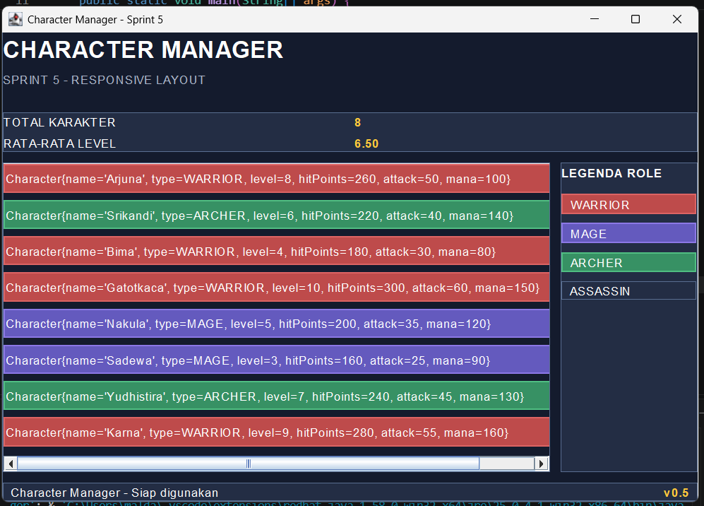

## TP12 — Sprint #5: Layout, UI Responsif & Analisis MVC

### A. Tujuan Praktikum

Pada TP12, aplikasi Character Manager dikembangkan menggunakan Layout Manager pada Java Swing. Tampilan aplikasi disusun menggunakan BorderLayout, BoxLayout, dan GridLayout agar komponen dapat menyesuaikan ukuran jendela.

### B. Wireframe Layout

```text
+------------------------------------------------------+
|                    NORTH: HEADER                     |
|                 CHARACTER MANAGER                    |
|------------------------------------------------------|
|                  STATISTICS PANEL                    |
|             GridLayout (2 Baris x 2 Kolom)            |
+-------------------------------+----------------------+
|                               |                      |
|          CENTER               |        EAST          |
|       JScrollPane             |    LEGEND PANEL      |
|                               |    BoxLayout Y_AXIS  |
|    Character List             |                      |
|    BoxLayout Y_AXIS           |    Warrior           |
|                               |    Archer            |
|    Character Cards            |    Mage              |
|                               |                      |
+-------------------------------+----------------------+
|                 SOUTH: STATUS BAR                    |
|  Character Manager - Siap digunakan             v0.5 |
+------------------------------------------------------+
```

### C. Hasil Tampilan Aplikasi

**1. Ukuran Awal**



**2. Jendela Diperlebar**


**3. Jendela Diperkecil**


### D. Struktur Panel

Aplikasi menggunakan Main Panel dengan BorderLayout sebagai wadah utama. Bagian NORTH berisi header dan panel statistik yang menggunakan GridLayout. Bagian CENTER berisi daftar karakter di dalam JScrollPane agar dapat digulir ketika ruang tampilan tidak mencukupi. Bagian EAST berisi legenda role dengan BoxLayout, sedangkan bagian SOUTH digunakan sebagai status bar yang menampilkan informasi aplikasi dan versi.

### E. Panel Tambahan dan Alasan Pemilihan Layout

Panel tambahan yang dibuat adalah Statistics Panel untuk menampilkan jumlah karakter dan rata-rata level. GridLayout 2x2 dipilih karena kedua informasi dapat disusun secara teratur dalam empat sel dengan ukuran yang sama.

BoxLayout dipilih untuk daftar karakter dan legenda karena komponen lebih sesuai ditampilkan secara vertikal. FlowLayout tidak dipilih untuk panel statistik karena susunan komponennya mengikuti aliran horizontal dan dapat berpindah baris ketika ruang tidak mencukupi.

### F. Pengujian Responsivitas

| Pengujian | Prediksi | Hasil Aktual |
|---|---|---|
| Ukuran awal | Komponen tersusun sesuai layout | Isi sesuai hasil pengujian |
| Jendela diperlebar | Area CENTER menyesuaikan ruang | Isi sesuai hasil pengujian |
| Jendela diperkecil | Scrollbar muncul jika daftar melebihi area tampilan | Isi sesuai hasil pengujian |

### G. Analisis MVC

Layout dan pengaturan tampilan ditempatkan di package `view` karena bagian tersebut bertanggung jawab terhadap antarmuka pengguna. Model tetap bertugas menyimpan dan mengelola data karakter, sedangkan tampilan bertugas menyajikan data tersebut kepada pengguna. Pemisahan ini membuat aplikasi lebih mudah dikembangkan dan dipelihara.

### H. Google Docs

Dokumen analisis TP12:

[https://1drv.ms/w/c/2131cfafda44bcb4/IQCV-YbfXtg_SqPeQCh7XRgTATVqgZqpldN1NzsTTXTPl9c?e=oUbOuQ]
