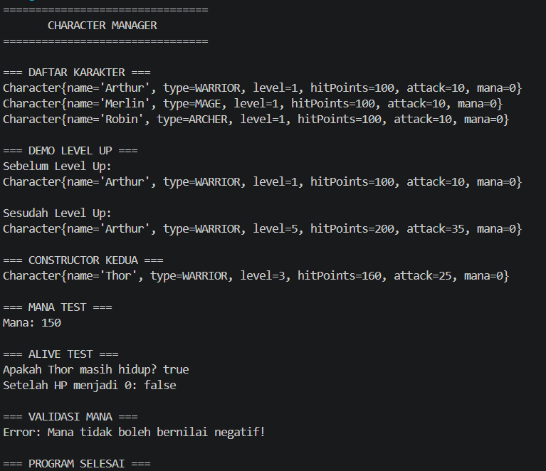

# Character Manager — TP3 (Java Visual SIH-6406)

## Deskripsi Project

Character Manager merupakan aplikasi berbasis Java yang dikembangkan untuk mengelola data karakter menggunakan konsep Object-Oriented Programming (OOP).

Pada TP3 Sprint-1 ini, project dikembangkan dengan menerapkan class, object, constructor, enum, encapsulation, getter, setter, serta method tambahan berupa `isAlive()` dan atribut `mana`.

Project ini merupakan implementasi dan pengembangan dari materi AP3 Belajar Praktik serta analisis desain berdasarkan AP2 Belajar Teori.

## Teknologi yang Digunakan

- Java JDK 17
- Visual Studio Code
- Git
- GitHub

## Struktur Folder Project

```text
CharacterManager/
│
├── src/
│   └── com/
│       └── unpri/
│           └── charactermanager/
│               ├── Main.java
│               │
│               └── model/
│                   ├── Character.java
│                   └── CharacterType.java
│
├── screenshots/
│   └── sprint-1-output.png
│
└── README.md
```

## Implementasi Fitur

### A. Implementasi Dasar

1. Package `com.unpri.charactermanager.model`.
2. Enum `CharacterType` dengan empat konstanta.
3. Class `Character` dengan dua constructor.
4. Getter dan setter lengkap.
5. Method `toString()`.
6. Program utama untuk menampilkan tiga karakter dan demonstrasi level up.

### B. Mini-Challenge

1. Menambahkan atribut private `mana` bertipe `int`.
2. Membuat getter `getMana()`.
3. Membuat setter `setMana(int mana)` dengan validasi nilai negatif menggunakan `IllegalArgumentException`.
4. Memperbarui `toString()` agar menampilkan mana.
5. Menambahkan method `isAlive()` yang mengembalikan `true` jika `hitPoints > 0`.

## Screenshot Hasil Program

Berikut merupakan bukti hasil pengujian program Character Manager Sprint-1.



## Git Branch

Branch pengembangan:

`feature/sprint-1`

## Informasi Mahasiswa

| Keterangan | Informasi |
|---|---|
| Nama Lengkap | M Aldafa Saf Ramadhan |
| NIM | 253303621214 |
| Mata Kuliah | Java Visual |
| Kode Mata Kuliah | SIH-6406 |
| Tugas | TP3 / AP3 |
| Sprint | Character Manager Sprint #1 |
| Dosen | Dr. Evta Indra |

## Dokumentasi Analisis Desain

Google Docs — Bagian D:

[https://1drv.ms/w/c/2131cfafda44bcb4/IQALqiI7G596R6zoCvr8Mt-1AWZWWpwnjIgt0uxH97bJ-Tg?e=dS0EI6]

---

**Character Manager Sprint #1**

Java Visual (SIH-6406)  
Universitas Prima Indonesia (UNPRI)